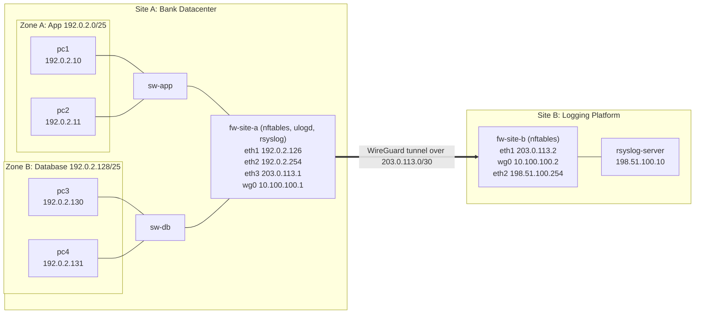

## 1. Design

### Diagram

The editable version is `NetTopoRFC5737.drawio` (draw.io). This Mermaid version renders directly on GitHub.



### IP plan

All site addresses come from the RFC 5737 documentation ranges. The tunnel itself uses a private RFC 1918 range.

| Segment | Subnet | Hosts |
|---|---|---|
| App zone (Site A) | `192.0.2.0/25` | pc1 `.10`, pc2 `.11`, fw-site-a eth1 `.126` (the zone's gateway) |
| Database zone (Site A) | `192.0.2.128/25` | pc3 `.130`, pc4 `.131`, fw-site-a eth2 `.254` (the zone's gateway) |
| Transit link (simulated untrusted network) | `203.0.113.0/30` | fw-site-a eth3 `.1`, fw-site-b eth1 `.2` |
| WireGuard tunnel (inside the transit link) | `10.100.100.0/30` | fw-site-a wg0 `.1`, fw-site-b wg0 `.2` |
| Logging platform (Site B) | `198.51.100.0/24` | fw-site-b eth2 `.254`, rsyslog-server eth1 `.10` |

### Links (from `bank-sec-lab.clab.yml`)

| Endpoint A | Endpoint B | Purpose |
|---|---|---|
| pc1:eth1 | sw-app | App zone |
| pc2:eth1 | sw-app | App zone |
| fw-site-a:eth1 | sw-app | Firewall leg into the App zone |
| pc3:eth1 | sw-db | Database zone |
| pc4:eth1 | sw-db | Database zone |
| fw-site-a:eth2 | sw-db | Firewall leg into the Database zone |
| fw-site-a:eth3 | fw-site-b:eth1 | Transit link carrying the tunnel |
| fw-site-b:eth2 | rsyslog-server:eth1 | Logging platform |

`sw-app` and `sw-db` are Linux bridges (containerlab `kind: bridge`) acting as Layer 2 switches.

### The path a log takes

1. A packet is blocked, or an allowed App-to-DB connection starts, on `fw-site-a`. An nftables rule with `log ... group 1` sends the packet's details to NFLOG group 1.
2. `ulogd`, running on `fw-site-a`, reads group 1 and writes one text line per event to syslog.
3. rsyslog on `fw-site-a` forwards every message as UDP syslog to `198.51.100.10:514`.
4. `fw-site-a` routes `198.51.100.0/24` into the `wg0` WireGuard interface.
5. WireGuard encrypts the packet and sends it as UDP port 51820 across the transit link (`203.0.113.1` to `203.0.113.2`).
6. `fw-site-b` decrypts it on `wg0`. Its forward chain allows exactly one flow: UDP 514 from `10.100.100.1` to `198.51.100.10`.
7. `rsyslog-server` receives the message and writes it to `/var/log/remote/<sender hostname>/syslog.log`.

```
nftables rule -> NFLOG group 1 -> ulogd -> syslog -> rsyslog -> WireGuard tunnel -> fw-site-b -> collector
```

### Firewall policy

Both firewalls drop everything that is not explicitly allowed.

**fw-site-a** (`configs/fw-site-a.nft`)

| Chain | Rule | Why it exists |
|---|---|---|
| input | policy **drop** | Default deny for traffic addressed to the firewall |
| input | established, related; loopback | Replies and local traffic |
| input | `eth3` UDP 51820 from `203.0.113.2` | WireGuard handshake from Site B |
| input | `eth1`/`eth2` ICMP echo-request | Zone hosts can ping their gateway |
| forward | policy **drop** | Default deny between zones |
| forward | established, related | Replies to allowed connections |
| forward | `eth1` to `eth2`, App to DB, TCP 5432, **logged** | The only allowed cross-zone flow |
| output | policy **drop** | Default deny for what the firewall sends |
| output | `eth3` UDP 51820 to `203.0.113.2` | The tunnel |
| output | `wg0` UDP 514 to `198.51.100.10` | The log flow |
| output | `wg0` ICMP echo-request to `10.100.100.2` | Tunnel health check |
| all three | last rule: **log** (IPv4, 10 per second), count, drop | Blocked traffic is logged, then dropped |

**fw-site-b** (set in `scripts/rebuild.sh`)

| Chain | Rule | Why it exists |
|---|---|---|
| input | policy **drop** | Default deny |
| input | established, related; loopback | Replies and local traffic |
| input | `eth1` UDP 51820 | The WireGuard handshake from Site A |
| input | `wg0` ICMP echo-request | Lets Site A ping the tunnel address |
| forward | policy **drop** | Default deny |
| forward | established, related | Replies |
| forward | `wg0` to `eth2`, `10.100.100.1` to `198.51.100.10`, UDP 514 | The only flow the log transport needs |

### Log format

`ulogd` writes one line per event in the style of the classic iptables LOG format. Example lines from this lab (trimmed):

```
fw-site-a ulogd[108]: FWA-DROP-FORWARD:  IN=eth1 OUT=eth2 MAC=... SRC=192.0.2.10 DST=192.0.2.130 LEN=84 ... PROTO=ICMP TYPE=8 CODE=0 ...
fw-site-a ulogd[108]: FWA-DROP-FORWARD:  IN=eth1 OUT=eth2 MAC=... SRC=192.0.2.10 DST=192.0.2.130 LEN=60 ... PROTO=TCP SPT=40411 DPT=2222 ... SYN ...
fw-site-a ulogd[108]: FWA-ACCEPT-APP2DB: IN=eth1 OUT=eth2 MAC=... SRC=192.0.2.10 DST=192.0.2.130 LEN=60 ... PROTO=TCP SPT=36629 DPT=5432 ... SYN ...
```

| Prefix | Meaning |
|---|---|
| `FWA-DROP-INPUT` | Blocked traffic addressed to the firewall |
| `FWA-DROP-FORWARD` | Blocked traffic between zones |
| `FWA-DROP-OUTPUT` | Blocked traffic the firewall itself tried to send |
| `FWA-ACCEPT-APP2DB` | A new, allowed App-to-DB connection |

`IN`/`OUT` are the interfaces, `SRC`/`DST` the addresses, `PROTO` the protocol, `SPT`/`DPT` the ports, and `SYN` marks the first packet of a TCP connection. A blocked TCP connection can appear twice, one second apart, because TCP resends its first packet. The double space after the prefix is added by ulogd and is harmless.

### Assumptions

1. The transit link `203.0.113.0/30` stands in for an untrusted network such as the internet. No real internet link is involved.
2. Containerlab also attaches every container to its own management network (`172.20.20.0/24` on `eth0`). I treat it as lab plumbing and ignore it in the design. It is not part of the log path, and no container ports are published. A real deployment would not have it. Tests must use the `192.0.2.x` addresses, because the management addresses bypass the firewall.
3. The containers need internet access during the build to download packages with `apk`. After the build, the log flow does not use it.
4. Only one log source is in scope: `fw-site-a`. `fw-site-b` does not forward its own logs.
5. Syslog uses plain UDP on port 514. The only encryption is the WireGuard tunnel. See Limitations.
6. The collector names each log folder after the sender's hostname. The template sanitises the name (`secpath-replace`) so a forged hostname cannot write outside `/var/log/remote/`.
7. WireGuard keys are generated fresh at every rebuild and are never stored in this repo.
8. Each zone is a `/25` (126 usable hosts), and the firewall takes the last usable address in each as the zone's gateway.
9. The example database flow is App zone to DB zone on TCP 5432 (PostgreSQL). The DB zone starts no connections. No other cross-zone traffic is allowed.
10. Traffic between two hosts in the same zone stays on the switch and is not filtered by the firewall.
11. The zone PCs use the firewall as their only default gateway. Their management-network default route is replaced for that reason, so they have no internet access.
12. Firewall logging covers IPv4 only. Blocked packets are logged at no more than 10 per second per chain, so that a flood cannot swamp the collector. Allowed App-to-DB connections are logged once per connection. Other allowed traffic (replies, WireGuard, gateway pings) is not logged.
13. `ulogd` is installed before the firewall rules are loaded, because the output rules also block the firewall's own internet access, which `apk` needs.

### Tool choices

| Function | Tool | Why |
|---|---|---|
| Workspace | GitHub Codespaces | Required by the brief. Browser-based and free. |
| Lab builder | containerlab | Describes the whole lab in one YAML file. |
| Firewalls | Alpine containers with nftables | Command-line only, which Codespaces supports. |
| Tunnel | WireGuard | Small and fast, with a short config. It is easy to inspect (`wg show`). Chosen over strongSwan to keep the moving parts few. |
| Firewall log capture | nftables NFLOG + ulogd | nftables' plain `log` action writes to the host's kernel log, which a container usually cannot read. NFLOG sends events to a program inside the container's own network namespace instead. |
| Collector | rsyslog | Standard syslog server, easy to configure per-host log folders. |
| Diagram | draw.io and Mermaid | Free. Mermaid renders on GitHub. |

---

## 2. Prerequisites

- A free GitHub account.
- This repo opened in **GitHub Codespaces** on the default **2-core** machine.
- In `github.com/settings/codespaces`, set the idle timeout to 10 minutes.
- Stop the codespace when you step away. Files are kept and only running time counts.
- Do not add a payment method. When the free quota runs out, Codespaces stops and does not charge.

---

## 3. Quick start

```bash
git pull --rebase
sh scripts/rebuild.sh
source scripts/shortcuts.sh
```

`rebuild.sh` runs steps 3 to 11 below from scratch and ends by proving the whole chain. A healthy run finishes like this:

```
All checks passed.
## 1. Start ulogd on fw-site-a
  ulogd is running
## 2. End-to-end test: a blocked packet should appear on the collector
  OK: a firewall drop event arrived at the collector:
  ... FWA-DROP-FORWARD: IN=eth1 OUT=eth2 ... SRC=192.0.2.10 DST=192.0.2.130 ...
```

Run it at the start of every session. The running lab (interfaces, tunnel, addresses, firewall rules) is lost whenever the codespace stops or restarts, and only the files in the repo remain. The script is safe to repeat because it redeploys the lab and flushes the firewall rules, so nothing piles up.

`source scripts/shortcuts.sh` only defines typing helpers (`$A`, `$B`, `$S`, `$PC1` to `$PC4`) for the manual commands in this README. The scripts do not need them.

---

## 4. Build it step by step

Steps 3 to 11 are exactly what the scripts do, with explanations. Run them from the repo root in the Codespaces terminal. Load the shortcuts first:

```bash
source scripts/shortcuts.sh
```

They are defined as:

```bash
A=clab-bank-sec-lab-fw-site-a
B=clab-bank-sec-lab-fw-site-b
S=clab-bank-sec-lab-rsyslog-server
PC1=clab-bank-sec-lab-pc1   # likewise PC2, PC3, PC4
```

### Step 1. Open the repo in Codespaces

On the repo page choose **Code > Codespaces > Create codespace on main**. The repo's `.devcontainer/devcontainer.json` installs Docker and containerlab. Check them:

```bash
containerlab version
docker ps
```

### Step 2. Read the topology file

`bank-sec-lab.clab.yml` defines 9 nodes: two bridges, two firewalls, four PCs and the collector, all `alpine:latest`. It also defines the 8 links listed in the Design section. It contains no IP addresses. Containerlab only creates the interfaces, and the address plan is applied in Steps 5 and 10.

### Step 3. Create the bridges and deploy

Containerlab's `bridge` nodes expect the Linux bridge to exist already, so create them first:

```bash
for b in sw-app sw-db; do
  sudo ip link add $b type bridge 2>/dev/null || true
  sudo ip link set $b up
done
sudo containerlab deploy -t bank-sec-lab.clab.yml --reconfigure
```

`--reconfigure` destroys any previous copy of the lab first, which gives a clean start. Afterwards `docker ps` should list seven containers.

### Step 4. Install the tools

Plain Alpine does not ship with the tools we need:

```bash
for n in $A $B; do
  docker exec $n apk add --no-cache iproute2 nftables wireguard-tools rsyslog
done
docker exec $S apk add --no-cache iproute2 rsyslog
docker exec $A apk add --no-cache ulogd
```

`iproute2` replaces BusyBox's limited `ip` command. `ulogd` captures firewall events (Step 11). It must be installed now, before Step 10 loads rules that block the firewall's internet access (Assumption 13).

### Step 5. Give interfaces their addresses and turn on routing

```bash
docker exec $A sh -c '
  for i in eth1 eth2 eth3; do ip link set $i up; done
  ip addr add 192.0.2.126/25 dev eth1
  ip addr add 192.0.2.254/25 dev eth2
  ip addr add 203.0.113.1/30 dev eth3
  sysctl -qw net.ipv4.ip_forward=1'

docker exec $B sh -c '
  for i in eth1 eth2; do ip link set $i up; done
  ip addr add 203.0.113.2/30 dev eth1
  ip addr add 198.51.100.254/24 dev eth2
  sysctl -qw net.ipv4.ip_forward=1'

docker exec $S sh -c '
  ip link set eth1 up
  ip addr add 198.51.100.10/24 dev eth1
  ip route add 10.100.100.0/30 via 198.51.100.254
  ip route add 192.0.2.0/24 via 198.51.100.254'
```

Check that the underlay works before building the tunnel on top of it:

```bash
docker exec $A ping -c2 -W1 203.0.113.2
```

### Step 6. Build the WireGuard tunnel

Each firewall generates its own key pair, and then each is told the other's public key:

```bash
for n in $A $B; do
  docker exec $n sh -c 'mkdir -p /etc/wireguard; umask 077; wg genkey > /etc/wireguard/priv; wg pubkey < /etc/wireguard/priv > /etc/wireguard/pub'
done
PUB_A=$(docker exec $A cat /etc/wireguard/pub)
PUB_B=$(docker exec $B cat /etc/wireguard/pub)

docker exec $A sh -c "
  ip link add wg0 type wireguard
  ip addr add 10.100.100.1/30 dev wg0
  wg set wg0 listen-port 51820 private-key /etc/wireguard/priv \
    peer $PUB_B endpoint 203.0.113.2:51820 \
    allowed-ips 10.100.100.2/32,198.51.100.0/24 persistent-keepalive 25
  ip link set wg0 up
  ip route add 198.51.100.0/24 dev wg0"

docker exec $B sh -c "
  ip link add wg0 type wireguard
  ip addr add 10.100.100.2/30 dev wg0
  wg set wg0 listen-port 51820 private-key /etc/wireguard/priv \
    peer $PUB_A allowed-ips 10.100.100.1/32,192.0.2.0/24
  ip link set wg0 up
  ip route add 192.0.2.0/24 dev wg0"
```

How it works:
- `allowed-ips` does two jobs. It is the routing table for the tunnel (which destinations go to this peer) and the filter for incoming packets (which source addresses are accepted from this peer).
- Site A knows Site B's endpoint (`203.0.113.2:51820`) and uses `persistent-keepalive` to open the connection. Site B only listens.
- Each side adds a route sending the other site's subnet into `wg0`.

### Step 7. Lock down Site B with nftables

```bash
docker exec -i $B nft -f - <<'NFT'
flush ruleset
table inet filter {
  chain input {
    type filter hook input priority 0; policy drop;
    ct state established,related accept
    iifname "lo" accept
    iifname "eth1" udp dport 51820 accept
    iifname "wg0" icmp type echo-request accept
  }
  chain forward {
    type filter hook forward priority 0; policy drop;
    ct state established,related accept
    iifname "wg0" oifname "eth2" ip saddr 10.100.100.1 ip daddr 198.51.100.10 udp dport 514 accept
  }
}
NFT
```

The rules are explained in the Firewall policy table. `flush ruleset` comes first so that running the step again replaces the rules instead of adding duplicates.

### Step 8. Set up rsyslog

**Collector** (`configs/rsyslog-server.conf`, copied in as `/etc/rsyslog.conf`):

```
module(load="imuxsock")
module(load="imudp")

template(name="PerHostFile" type="string"
         string="/var/log/remote/%HOSTNAME:::secpath-replace%/syslog.log")

ruleset(name="from_network") {
    action(type="omfile" dynaFile="PerHostFile"
           dirCreateMode="0755" fileCreateMode="0644")
}

input(type="imudp" port="514" ruleset="from_network")

# the server's own local logs go to a normal file
*.* /var/log/messages
```

The `ruleset` is bound to the UDP input so that only network messages go into the per-host folders. The server's own logs stay in `/var/log/messages`.

```bash
docker cp configs/rsyslog-server.conf $S:/etc/rsyslog.conf
docker exec $S rsyslogd
```

**Sender** (`fw-site-a`) forwards everything to the collector with a single rule:

```bash
docker exec -i $A sh -c 'cat > /etc/rsyslog.conf' <<'RS'
module(load="imuxsock")
*.* @198.51.100.10:514
RS
docker exec $A rsyslogd
```

A single `@` means UDP. Use this config only once. Two copies of the forwarding line send every log twice.

### Step 9. Send a test log and check it arrived

```bash
docker exec $A logger -t rebuild-test "hello from fw-site-a"
sleep 2
docker exec $S sh -c 'find /var/log/remote -type f; cat /var/log/remote/*/syslog.log'
```

Expected: the file `/var/log/remote/fw-site-a/syslog.log` exists and contains `rebuild-test: hello from fw-site-a`. The folder name is the sender's hostname, which is how the collector tells devices apart. At this point the tunnel and log path work, but only with a hand-made test message.

### Step 10. Zones: PC addresses and the Site A firewall (`scripts/zones.sh`)

Each PC gets an address in its zone and uses the firewall's leg in that zone as its gateway. For `pc1`:

```bash
docker exec $PC1 sh -c '
  ip link set eth1 up
  ip addr flush dev eth1
  ip addr add 192.0.2.10/25 dev eth1
  ip route replace default via 192.0.2.126'
```

The same pattern applies to the other PCs:

| PC | Address | Gateway |
|---|---|---|
| pc1 | `192.0.2.10/25` | `192.0.2.126` |
| pc2 | `192.0.2.11/25` | `192.0.2.126` |
| pc3 | `192.0.2.130/25` | `192.0.2.254` |
| pc4 | `192.0.2.131/25` | `192.0.2.254` |

Then the firewall ruleset is copied in and loaded:

```bash
docker cp configs/fw-site-a.nft $A:/etc/fw-site-a.nft
docker exec $A nft -f /etc/fw-site-a.nft
```

The script then runs five ping checks: the PCs reach their gateways, `pc1` reaches `pc2` (same zone), `pc1` cannot reach `pc3` (blocked), and the firewall still reaches the far end of the tunnel.

Because the PCs' default route now points at the firewall, they cannot download packages. That is intended.

### Step 11. Real firewall logs (`scripts/logging.sh`)

The final rule of each firewall chain, and the allowed App-to-DB rule, contain `log prefix "..." group 1`. That hands the packet details to NFLOG group 1. `ulogd` listens on that group (`configs/ulogd.conf`) and writes to syslog:

```
stack=log1:NFLOG,base1:BASE,ifi1:IFINDEX,ip2str1:IP2STR,print1:PRINTPKT,sys1:SYSLOG
```

Read left to right, the stack takes packets from NFLOG, decodes them, resolves interface names and addresses, formats one line of text, and sends it to syslog. Start it:

```bash
docker cp configs/ulogd.conf $A:/etc/ulogd.conf
docker exec $A sh -c 'pkill ulogd 2>/dev/null; sleep 1; ulogd -d -c /etc/ulogd.conf'
```

The script then sends a blocked ping from `pc1` to `pc3` and checks that a `FWA-DROP-FORWARD` line appears on the collector. rsyslog on `fw-site-a` forwards it with everything else, so no change to the rsyslog config was needed.

---

## 5. Verify it works

```bash
# Tunnel is up: expect a "latest handshake" line and non-zero transfer in both directions
docker exec $A wg show

# The tunnel itself answers: should WORK
docker exec $A ping -c2 -W1 10.100.100.2

# The collector is not pingable, only UDP 514 is allowed: should FAIL
docker exec $A ping -c2 -W1 198.51.100.10

# Site B firewall: policy drop on both chains, each rule listed once
docker exec $B nft list ruleset
```

### Zone rules

```bash
docker exec $PC1 ping -c2 -W1 192.0.2.126    # works: its gateway
docker exec $PC1 ping -c2 -W1 192.0.2.11     # works: same zone, never touches the firewall
docker exec $PC1 ping -c2 -W1 192.0.2.130    # FAILS: App to DB ping is not allowed
docker exec $PC3 ping -c2 -W1 192.0.2.254    # works: DB zone's gateway
```

Pinging `192.0.2.254` from the App zone also works. That packet is addressed to the firewall itself, so the input chain judges it, not the forward chain. Do not use it to test zone blocking.

Test the database flow with listeners. An empty file proves the firewall stopped the traffic, because a listener was waiting:

```bash
# allowed: App to DB on 5432 (the message arrives)
docker exec -d $PC3 sh -c 'nc -l -p 5432 > /tmp/db-received.txt'
docker exec $PC1 sh -c 'echo "hello db from pc1" | nc -w 2 192.0.2.130 5432'
sleep 1
docker exec $PC3 cat /tmp/db-received.txt

# blocked: wrong port, App to DB (file stays empty)
docker exec -d $PC3 sh -c 'nc -l -p 2222 > /tmp/blocked-port.txt'
docker exec $PC1 sh -c 'echo "should be blocked" | nc -w 2 192.0.2.130 2222'
docker exec $PC3 cat /tmp/blocked-port.txt

# blocked: wrong direction, DB to App (file stays empty)
docker exec -d $PC1 sh -c 'nc -l -p 5432 > /tmp/blocked-dir.txt'
docker exec $PC3 sh -c 'echo "should be blocked" | nc -w 2 192.0.2.10 5432'
docker exec $PC1 cat /tmp/blocked-dir.txt

# clean up listeners that are still waiting
docker exec $PC3 pkill nc
docker exec $PC1 pkill nc
```

The firewall's own counters show the same thing. The `tcp dport 5432` rule and the final `counter drop` should both show `packets` greater than 0:

```bash
docker exec $A nft list chain inet filter forward
```

### Firewall logs on the collector

After running the tests above:

```bash
docker exec $S grep FWA- /var/log/remote/fw-site-a/syslog.log
```

Expected, in the order the tests ran:

| Test | Log line |
|---|---|
| `pc1` pings `pc3` | `FWA-DROP-FORWARD` with `PROTO=ICMP TYPE=8`, `SRC=192.0.2.10`, `DST=192.0.2.130` |
| `pc1` to `pc3` on port 2222 | `FWA-DROP-FORWARD` with `DPT=2222` and `SYN` (possibly twice) |
| `pc3` connects to `pc1` on 5432 | `FWA-DROP-FORWARD` with `IN=eth2 OUT=eth1` and `SRC=192.0.2.130` |
| `pc1` connects to `pc3` on 5432 | One `FWA-ACCEPT-APP2DB` line |

### Logs cross the tunnel

The sent-bytes counter should jump by several thousand bytes, and the collector should count 50 messages:

```bash
docker exec $A wg show wg0 transfer
docker exec $A sh -c 'for i in $(seq 1 50); do logger -t proof "burst $i"; done'
sleep 1
docker exec $A wg show wg0 transfer
docker exec $S grep -c burst /var/log/remote/fw-site-a/syslog.log
```

The `transfer` line shows bytes received, then bytes sent, from `fw-site-a`'s point of view. A single message is hard to see in the counter because WireGuard's keepalives also add bytes, which is why the test sends 50. If you run the burst again, the count on the collector grows by another 50.

More commands are collected in `verification_commands.txt`.

---

## 6. Failure test (TODO)

> **TODO (stretch).** Planned: take the tunnel down (for example `docker exec $A ip link set wg0 down`), send logs and trigger firewall events, then show what breaks, what is lost and how it would be detected. Things to check and write up:
> - Does the collector file stop growing? Do the messages sent during the outage ever arrive after the tunnel returns?
> - Detection ideas: the age of the `latest handshake` in `wg show`, a failing ping to `10.100.100.2`, or an alert when the collector receives no messages from a host for a set time.

---

## 7. Common problems

These all happened while building this lab.

| Symptom | Cause | Fix |
|---|---|---|
| Logs land in the wrong folder or only appear under the server's own hostname | Two rsyslog configs defined the same template, or a rule caught every message | Use one config file and bind the network ruleset to the UDP input (Step 8) |
| `ip -br` prints a usage message | BusyBox `ip` is limited | Install `iproute2` (Step 4) |
| Same nftables rule appears several times | Rules were appended on every run | Start with `flush ruleset` (Step 7) |
| `wg show` lists an old peer or 0 B received | Stale peer from an earlier key, or no connectivity on the underlay | Rebuild with fresh keys, and run the underlay ping from Step 5 |
| `can't find device 'eth1'`, or only `eth0` on every container | The codespace restarted, so the running lab was lost | Run `sh scripts/rebuild.sh` |
| `lstat ... fw-site-a.nft: no such file or directory` | The ruleset file is not in `configs/` | Move it to `configs/` |
| `apk add` fails on `fw-site-a` | The firewall's output rules block its internet access | Install packages in Step 4, before the rules load. To add a package later, rebuild |
| `ulogd is not running` | Bad plugin path or config | `docker exec $A cat /var/log/ulogd.log` names the problem |
| `nft` rejects a `log ... group 1` line | The NFLOG kernel module is not loaded on the host | `sudo modprobe nfnetlink_log`, then rebuild |
| PC cannot reach its gateway | Docker's firewall may be filtering the Linux bridges | `ip link show master sw-app` should list three interfaces. If `sysctl net.bridge.bridge-nf-call-iptables` prints `1`, run `sudo sysctl -w net.bridge.bridge-nf-call-iptables=0` and rebuild |
| `git push` fails on the Git LFS hook | `git-lfs` is not installed and the repo has the LFS hooks | Delete `.git/hooks/pre-push` and `post-commit`, or push with `--no-verify` |
| `git push` is rejected with "fetch first" | GitHub has a commit the codespace does not | `git pull --rebase`, resolve any conflicts, then push |

### Repo hygiene

- `.gitignore` excludes `clab-*/` (containerlab's generated folder, which includes a throwaway CA key) and `diag*.txt` (diagnostic output).
- Do not force-add ignored files (`git add -f`).
- Start each session with `git pull --rebase`, and run `git status --short` before committing.

---

## 8. Limitations

- **No end-to-end encryption.** Logs are plain UDP syslog. They are protected only while inside the WireGuard tunnel, and they are readable on the Site A and Site B firewalls and on the hosts. rsyslog itself warns about this at startup. Stretch item 8 would add TLS from rsyslog to rsyslog.
- **Logs can be lost.** UDP has no delivery guarantee, and neither rsyslog nor ulogd queues messages to disk while the tunnel is down.
- **Rate-limited drop logging.** Past 10 blocked packets per second per chain, extra drops are still dropped and counted but not logged. That protects the collector but hides the size of a flood. The counters in `nft list ruleset` show the true numbers.
- **Not everything is logged.** Only blocked IPv4 traffic and new App-to-DB connections produce log lines (Assumption 12). Traffic inside a zone never reaches the firewall.
- **All firewall events share one file.** `ulogd` messages and other `fw-site-a` messages go into the same `syslog.log` on the collector, distinguished by the program name and the `FWA-` prefix.
- **The management network is still there.** Containerlab's `eth0` network connects every container. It is outside the design (Assumption 2).
- **The rebuild is a script around containerlab,** not a single topology file.

---

## 9. Repository layout

| Path | Contents |
|---|---|
| `bank-sec-lab.clab.yml` | containerlab topology: nodes and links |
| `scripts/rebuild.sh` | One-command build of the whole lab. Calls the two scripts below at the end |
| `scripts/zones.sh` | PC addresses, Site A firewall rules and zone checks |
| `scripts/logging.sh` | Starts ulogd and tests the firewall-log path end to end |
| `scripts/shortcuts.sh` | Typing helpers for the commands in this README |
| `configs/rsyslog-server.conf` | Collector configuration |
| `configs/fw-site-a.nft` | Site A firewall ruleset, including the log rules |
| `configs/ulogd.conf` | ulogd configuration (NFLOG group 1 to syslog) |
| `NetTopoRFC5737.drawio` | Editable topology diagram |
| `verification_commands.txt` | Commands used to check the lab |
| `LEARNING.md` | Daily learning log |
| `.devcontainer/` | Codespaces environment definition |
| `.gitignore` | Keeps generated files and diagnostics out of the repo |

---

## 10. Resources and AI use

- Documentation: containerlab, WireGuard, nftables wiki, rsyslog, ulogd.
- An AI assistant (Claude) was used to explain concepts, troubleshoot errors and draft the scripts, the firewall ruleset and this README. Every command was run in the lab and its output checked. `LEARNING.md` records what was tried, what broke and where each lesson came from.
